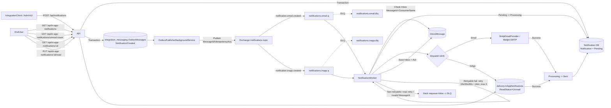

# Notification System

Hệ thống gửi thông báo Modular Monolith (.NET 10 + Angular AdminUI), hỗ trợ kênh `Email` và `InAppNotification`, xử lý bất đồng bộ qua RabbitMQ + Outbox/Inbox, có retry/DLQ và API pull/polling cho in-app.

## Thành phần chính

- **API** (`src/Hosts/Api`): nhận yêu cầu tạo/truy vấn Thông báo, xác thực JWT + RBAC, health check.
- **Worker** (`src/Hosts/Worker`): publish Outbox, consume RabbitMQ, dispatch kênh, retry/DLQ, cập nhật trạng thái.
- **AdminUI** (`src/Clients/AdminUI`): giao diện quản trị.
- **PostgreSQL**: lưu dữ liệu nghiệp vụ, Outbox/Inbox, InAppNotification, AuditLog...
- **RabbitMQ**: exchange/queue/DLQ cho luồng bất đồng bộ.
- **Mailpit** (dev): SMTP test cho kênh Email.

## Chạy local bằng Docker Compose

```bash
docker compose -f docker/docker-compose.yml up -d --build
```

Mặc định:
- API: `http://localhost:8080`
- AdminUI: `http://localhost:4200`
- RabbitMQ Management: `http://localhost:15672` (`guest/guest`)
- Mailpit UI: `http://localhost:8025`
- PostgreSQL: `localhost:5432`

Biến môi trường có thể đặt trong `.env` ở root repo (compose đã `env_file: ../.env`).

## Luồng chạy hiện tại



## Chi tiết luồng

### 1. Tạo Thông báo

- Endpoint: `POST /api/notifications` (RBAC: `IntegrationClient`).
- `CreateNotificationUseCase` validate input, parse channel (`email`/`inapp`), kiểm tra idempotency theo scope caller.
- Tạo `Notification` trạng thái `Pending`, lưu `notification.Notifications`.
- Cùng transaction ghi `OutboxMessageRecord` vào `integration_messaging.OutboxMessages` (event `NotificationCreated`, có `MessageId`).

### 2. Publish Outbox

- `OutboxPublisherBackgroundService` quét outbox pending/đến hạn.
- Publish qua `IRabbitMqMessagePublisher` lên `notifications.topic`.
- Routing key:
  - `notification.email.created` -> `notifications.email.q`
  - `notification.inapp.created` -> `notifications.inapp.q`
- Publish thành công: đánh dấu outbox đã publish; lỗi: tăng retry/backoff theo policy.

### 3. Consume Worker + Dispatch kênh

- `NotificationWorker` consume 2 queue, manual ack, concurrency cấu hình (`RabbitMq:ConsumerConcurrency`, mặc định 5).
- Kiểm tra `MessageId` hợp lệ; invalid -> Nack DLQ.
- Idempotency consumer: bảng `InboxMessage`, unique `(MessageId, ConsumerName="NotificationWorker")`.
- Với message mới:
  - Load `Notification`; nếu `Pending` -> `MarkProcessing()`.
  - Dispatch qua `INotificationChannelDispatcher`:
    - **Email**: `EmailSender` render template/fallback HTML/plain-text, gửi bằng `IEmailProvider` (`SmtpEmailProvider`/Mailpit).
    - **InApp**: `CreateInAppNotificationUseCase` tạo `InAppNotification` (`Unread`), idempotent theo `NotificationId + RecipientUserId`.
  - Lưu `InboxMessage`.
  - Nếu dispatch thành công: `Processing -> Sent`, `SaveChanges`, `Ack`.

### 4. Retry / DLQ

- Retryable lỗi tạm thời (timeout, HTTP request, IO, socket, ...): retry tối đa 3 lần, delay 10s/30s/90s + jitter, cap 2 phút.
- Non-retryable (`ArgumentException`, `JsonException`, `FormatException`, `OperationCanceledException`) hoặc hết retry: `Nack(requeue:false)` -> DLQ.
- DLQ có thể xem/resend qua Administration API (RBAC + idempotency + AuditLog).

### 5. InApp pull/polling

- `GET /api/in-app-notifications?unreadOnly=&page=&pageSize=`: danh sách của người dùng hiện tại.
- `GET /api/in-app-notifications/unread-count`: số chưa đọc.
- `GET /api/in-app-notifications/{id}`: chi tiết.
- `PUT /api/in-app-notifications/{id}/read`: đánh dấu đã đọc (idempotent).
- API lọc theo claim `sub`/`NameIdentifier`.

## Trạng thái chính

- **NotificationStatus**: `Pending -> Processing -> Sent` (hoặc `Failed`/resend flow theo nghiệp vụ).
- **ReadStatus (InAppNotification)**: `Unread -> Read`.

## Cấu trúc thư mục

```text
src/
  Hosts/
    Api/                # HTTP API host
    Worker/             # Background worker host
  Modules/
    Administration/     # DLQ/Audit/Admin operations
    Delivery/           # Email/InApp dispatch, InApp storage/query
    IdentityAccess/     # JWT/RBAC
    IntegrationMessaging/ # Outbox/Inbox/RabbitMQ topology
    Notification/       # Notification domain/application
  BuildingBlocks/       # SharedKernel, Observability
  Clients/
    AdminUI/            # Angular admin UI
docs/                   # PRD, architecture, status, deploy...
docker/                 # docker-compose, Dockerfiles
tests/                  # Unit/Integration/E2E
```

## Tài liệu liên quan

- `docs/prd.md` - yêu cầu nghiệp vụ
- `docs/architecture.md` - kiến trúc và quyết định kỹ thuật
- `docs/status.md` - tiến độ story/phase
- `docs/deploy.md` - hướng dẫn deploy/vận hành
- `docs/domain-glossary.md` - thuật ngữ chuẩn
