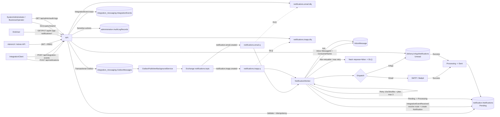

# Notification System

Hệ thống gửi thông báo Modular Monolith (.NET 10 + Angular AdminUI). Hỗ trợ kênh `Email` và `InAppNotification`, xử lý bất đồng bộ qua RabbitMQ + Outbox/Inbox, retry/DLQ/resend, RBAC, và quản trị cấu hình qua AdminUI.

## Thành phần chính

- **API** (`src/Hosts/Api`): HTTP API, JWT + RBAC, health check, nghiệp vụ Notification/Admin/Identity/InApp.
- **Worker** (`src/Hosts/Worker`): publish Outbox, consume RabbitMQ, dispatch kênh, retry/DLQ, cập nhật trạng thái.
- **AdminUI** (`src/AdminUI`): Angular + Material, quản trị vận hành và cấu hình.
- **PostgreSQL**: dữ liệu nghiệp vụ, Outbox/Inbox, InAppNotification, AuditLog, cấu hình, Identity.
- **RabbitMQ**: exchange/queue/DLQ cho luồng bất đồng bộ.
- **Mailpit** (dev): SMTP test cho kênh Email.

## Chạy local bằng Docker Compose

```bash
docker compose -f docker/docker-compose.yml up -d --build
```

Mặc định:
- API: `http://localhost:8080`
- AdminUI: `http://localhost:4200`
- RabbitMQ Management: `http://localhost:15672` (`guest/guest`)
- Mailpit UI: `http://localhost:8025`
- PostgreSQL: `localhost:5432`

Biến môi trường: `.env` ở root repo (compose dùng `env_file: ../.env`). Không commit secret.

## Luồng chính hiện tại



## Chi tiết luồng

### 1. Xác thực & phân quyền

- JWT Bearer + RBAC: `SystemAdministrator`, `BusinessOperator`, `IntegrationClient`.
- AdminUI: đăng nhập/đăng xuất, guard theo vai trò, quên/đặt lại mật khẩu.
- IdentityAccess hỗ trợ credential nội bộ, client credentials cho `IntegrationClient`, quản lý user/role/credential, hồ sơ `EndUser`.

### 2. Tạo & xử lý Thông báo

- `POST /api/notifications` (RBAC: `IntegrationClient`): validate, idempotency theo scope caller, tạo `Notification=Pending`, ghi Outbox cùng transaction.
- Outbox Publisher publish message lên `notifications.topic` với routing key theo kênh.
- Worker consume manual ack, kiểm tra `MessageId`, idempotency bằng `InboxMessage(MessageId, ConsumerName)`.
- Dispatch:
  - **Email**: render template/fallback HTML/plain-text, gửi qua `IEmailProvider` (SMTP/Mailpit).
  - **InApp**: tạo `InAppNotification` (`Unread`), idempotent theo `NotificationId + RecipientUserId`.
- Thành công: `Processing -> Sent`; lỗi tạm thời retry có backoff+jitter; lỗi không phục hồi/vượt ngưỡng -> DLQ.

### 3. IntegrationEvent end-to-end (Phase 11, code đã triển khai)

- `POST /api/integration-events` (RBAC: `IntegrationClient`): validate envelope `messageId,eventId,eventType,occurredAt,source,idempotencyKey,version,payload`.
- Kiểm tra idempotency theo `MessageId`; trùng trả `200` + `Duplicate=true`.
- Resolve `IntegrationEventRoute` active theo `eventType`; validate mapping/payload tối thiểu (`recipient`, `channel` hoặc route channel, `content` hoặc template).
- Lưu `IntegrationEvent` + `OutboxMessage` (`IntegrationEventReceived`) trong cùng transaction DB của IntegrationMessaging.
- Outbox Publisher publish sang RabbitMQ; Worker consume, tạo `Notification` idempotent, dispatch kênh, ack/inbox.
- Trạng thái xác nhận test: xem `docs/status.md`.

### 4. Retry / DLQ / Resend / AuditLog

- Retry tối đa 3 lần, delay 10s/30s/90s + jitter, cap 2 phút.
- Non-retryable hoặc hết retry: Nack `requeue=false` vào DLQ.
- Administration API/AdminUI hỗ trợ xem DLQ và `Resend` theo RBAC, có idempotency + AuditLog.
- `GET /api/admin/audit-logs` (RBAC: `AuditLogRead`): truy vấn AuditLog theo `action,targetType,actorUserId,fromUtc,toUtc,page,pageSize`.
- AuditLog ghi cho thao tác nhạy cảm: `Resend` DLQ và CRUD cấu hình `NotificationTemplate`/`NotificationChannelConfig`/`IntegrationEventRoute`.
- Trạng thái xác nhận test: xem `docs/status.md`.

### 5. InApp pull/polling

- `GET /api/in-app-notifications?unreadOnly=&page=&pageSize=`
- `GET /api/in-app-notifications/unread-count`
- `GET /api/in-app-notifications/{id}`
- `PUT /api/in-app-notifications/{id}/read` (idempotent)
- Lọc theo claim `sub`/`NameIdentifier`.

### 6. Cấu hình quản trị (Phase 10)

- `NotificationTemplate`: CRUD `/api/admin/notification-templates`.
- `NotificationChannelConfig`: CRUD `/api/admin/notification-channel-configs`, không lộ secret.
- `IntegrationEventRoute`: CRUD `/api/admin/integration-event-routes`, mapping event -> template/kênh, validate thiếu mapping/trùng event type.
- RBAC: `SystemAdministrator`.
- AdminUI có màn hình quản lý tương ứng (danh sách/form CRUD, loading/empty/error/success, filter Áp dụng/Xóa bộ lọc).

## Trạng thái chính

- **NotificationStatus**: `Pending -> Processing -> Sent/Failed` (có luồng resend theo nghiệp vụ).
- **ReadStatus (InAppNotification)**: `Unread -> Read`.

## Cấu trúc thư mục

```text
src/
  Hosts/
    Api/                    # HTTP API host
    Worker/                 # Background worker host
  Modules/
    Administration/         # Dashboard, DLQ/Audit/Admin operations
    Delivery/               # Email/InApp dispatch, InApp storage/query
    IdentityAccess/         # JWT/RBAC, user/credential/reset password
    IntegrationMessaging/   # IntegrationEvent, Outbox/Inbox/RabbitMQ topology
    Notification/           # Notification domain/application
    TemplateConfiguration/  # NotificationTemplate, NotificationChannelConfig, IntegrationEventRoute
  BuildingBlocks/           # SharedKernel, Observability
  AdminUI/                  # Angular AdminUI
docs/                       # PRD, architecture, status, deploy...
docker/                     # docker-compose, Dockerfiles
tests/                      # Unit/Integration/E2E
```

## Kiểm thử

```bash
# .NET
dotnet test tests/UnitTests/UnitTests.csproj
dotnet test tests/IntegrationTests/IntegrationTests.csproj
dotnet test tests/E2ETests/E2ETests.csproj

# AdminUI
cd src/AdminUI
npm install
npm run build
npm test -- --watch=false --browsers=ChromeHeadless
```

## Tài liệu liên quan

- `docs/prd.md` - yêu cầu nghiệp vụ
- `docs/architecture.md` - kiến trúc và quyết định kỹ thuật
- `docs/status.md` - tiến độ story/phase (nguồn sự thật tiến độ)
- `docs/deploy.md` - hướng dẫn deploy/vận hành
- `docs/domain-glossary.md` - thuật ngữ chuẩn
- `docs/ux.md` - đặc tả UI
- `docs/conventions.md` - quy ước code/test
