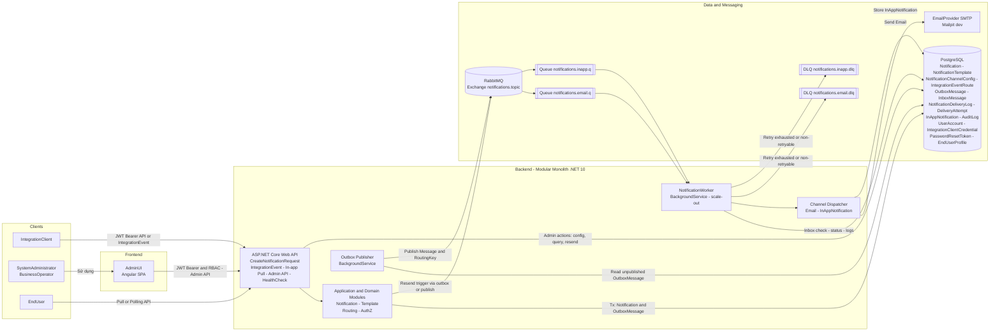

# Kiến trúc hệ thống — Notification System

> Tài liệu này mô tả kiến trúc mục tiêu cho MVP, bám sát `docs/prd.md` (FR/NFR, ràng buộc thực tế) và dùng thuật ngữ chuẩn trong `docs/domain-glossary.md` (ưu tiên tên tiếng Anh/code cho module, entity, bảng dữ liệu).

## 1. Kiến trúc tổng quan

### 1.1 Mô tả
Hệ thống áp dụng **Modular Monolith** trên **.NET 10 / ASP.NET Core**. **Mỗi module backend được tổ chức theo Clean Architecture riêng** (gồm các lớp `Domain`, `Application`, `Infrastructure`, `Presentation` và tuân thủ quy tắc phụ thuộc hướng vào Domain) để phù hợp team 1 developer, triển khai nhanh bằng Docker Compose nhưng vẫn giữ ranh giới rõ cho việc mở rộng và bảo trì (NFR-08).

Luồng chính:
- **Tiếp nhận:** `IntegrationClient` tạo `Notification` qua API (`CreateNotificationRequest`, JWT Bearer) hoặc hệ thống nguồn phát `IntegrationEvent`. API xác thực/ủy quyền (RBAC), validate, áp dụng `Idempotency` (`IdempotencyKey`/`MessageId`), lưu `Notification` (`Pending`) và ghi `OutboxMessage` trong cùng transaction DB (`TransactionalOutbox`) để đảm bảo nhất quán DB–broker (FR-01, FR-02, FR-03, NFR-07).
- **Quản lý danh tính & truy cập (bổ sung, DEC-001→DEC-005):** `IdentityAccess` quản lý `UserAccount`/vai trò, credential nội bộ (hash), `IntegrationClientCredential` (client id/secret), phát `JwtBearer` cho đăng nhập `AdminUI` và client credentials của `IntegrationClient`, luồng đặt lại mật khẩu (`PasswordResetToken` gửi email), và `EndUserProfile` (khóa theo định danh hệ thống nguồn) phục vụ quản trị/nhận `InAppNotification`. Thiết kế abstraction để mở rộng tích hợp IdP/SSO sau.
- **Phát hành & vận chuyển:** Outbox publisher đọc `OutboxMessage` chưa publish, gửi `Message` tới RabbitMQ `Exchange` (`notifications.topic`) với `RoutingKey` theo `NotificationChannel` vào `Queue` tương ứng (`notifications.email.q`, `notifications.inapp.q`) và đánh dấu outbox đã xử lý (FR-04).
- **Xử lý nền:** `NotificationWorker` (BackgroundService, scale-out độc lập) consume `Message`, ghi/kiểm tra `InboxMessage` để chống trùng (`InboxPattern`, `MessageId`), chuyển `NotificationStatus` (`Pending` → `Processing` → `Sent`/`Failed`), tạo `DeliveryAttempt` và cập nhật `NotificationDeliveryLog` (FR-05, FR-06, FR-07, FR-10, FR-14).
- **Gửi theo kênh:** Dispatcher chọn handler theo `NotificationChannel` (abstraction cho mở rộng): `Email` gửi qua `EmailProvider` SMTP (Mailpit dev), `InAppNotification` lưu DB để `EndUser` truy xuất qua API pull/polling và cập nhật `ReadStatus` (FR-11, FR-12, FR-13).
- **Chịu lỗi:** Lỗi tạm thời (timeout/network/5xx) được `Retry` tối đa 3 lần với `ExponentialBackoff` + jitter; quá ngưỡng hoặc lỗi không phục hồi chuyển `DeadLetterQueue` (DLQ). `SystemAdministrator`/`BusinessOperator` thao tác tra cứu và `Resend` qua `AdminUI` (FR-08, FR-09, FR-16), có `AuditLog`.
- **Quan sát:** `StructuredLog` (Serilog) + `CorrelationId` (`messageId`, `notificationId`, trace id), OpenTelemetry cơ bản, `HealthCheck` (`/health`, `/health/ready`) cho API/DB/RabbitMQ (FR-15, NFR-06).

Database PostgreSQL là **source of truth**; RabbitMQ chỉ đảm nhiệm vận chuyển `Message` (at-least-once). Redis nằm ngoài MVP (chỉ cân nhắc sau khi có số liệu).

### 1.2 Sơ đồ tổng quan (Mermaid)

## 2. Tech Stack

| Thành phần | Lựa chọn | Lý do (gắn FR/NFR/ràng buộc) |
|---|---|---|
| Backend runtime/framework | **.NET 10, ASP.NET Core Web API** | Ràng buộc kỹ thuật; hỗ trợ tốt `BackgroundService`, DI, middleware, hiệu năng phù hợp mục tiêu NFR-01; thuận tiện xây Modular Monolith/Clean Architecture (NFR-08) cho 1 developer. |
| Kiến trúc ứng dụng | **Modular Monolith; mỗi module backend là một Clean Architecture (Domain/Application/Infrastructure/Presentation), DDD/CQRS khi phù hợp** | Ràng buộc; giảm vận hành phức tạp so với microservices trong MVP, vẫn giữ ranh giới module và khả năng tiến hóa (NFR-03, NFR-08). CQRS áp dụng chọn lọc cho luồng đọc/ghi tách biệt (tiếp nhận vs truy vấn vận hành). |
| Frontend / Admin UI | **Angular (SPA) cho `AdminUI`** | Đáp ứng FR-16 (Admin UI cho `SystemAdministrator`/`BusinessOperator`), phù hợp stack của Đại ca; giao tiếp với ASP.NET Core Web API qua HTTP dùng `JwtBearer` + `RBAC` (NFR-05). Triển khai tách frontend (build static, phục vụ qua Nginx/container riêng hoặc tương đương) trong Docker Compose, song song backend modular monolith (NFR-10). |
| Database | **PostgreSQL 16+** | Ràng buộc; ACID transaction cho `TransactionalOutbox`/`InboxPattern`, unique constraint cho `Idempotency`, truy vấn lịch sử/trạng thái ổn định (FR-03, FR-06, FR-10, FR-14, NFR-02, NFR-07). |
| ORM / Data access | **Entity Framework Core** | Ràng buộc; tăng tốc phát triển, migration, mapping entity rõ; dùng parameterized query để giảm rủi ro injection (NFR-05). Tối ưu truy vấn nóng bằng projection/index khi cần (NFR-01). |
| Message Broker | **RabbitMQ** | Ràng buộc; tách tiếp nhận và gửi bất đồng bộ (FR-04, FR-05, FR-07, NFR-01), hỗ trợ ack, routing, DLQ và mô hình at-least-once phù hợp NFR-02/NFR-04. Không dùng Kafka trong MVP theo phạm vi. |
| Background processing | **.NET BackgroundService** (+ hosted services cho outbox publisher/worker) | Ràng buộc; thực thi `OutboxMessage` publishing và `NotificationWorker` tiêu thụ queue với concurrency cấu hình (FR-07), hỗ trợ scale-out nhiều instance (NFR-03). |
| Authentication/Authorization | **JWT Bearer + RBAC** (`SystemAdministrator`, `BusinessOperator`, `IntegrationClient`) | Quyết định PRD; bảo vệ API/Admin UI và thao tác nhạy cảm như `Resend`/DLQ/cấu hình (FR-01, FR-06, FR-09, FR-16, NFR-05). |
| Logging / Observability | **Serilog + OpenTelemetry** | Ràng buộc & NFR-06; `StructuredLog` với `CorrelationId` (`messageId`, `notificationId`, trace id), traces/metrics cơ bản cho HTTP/EF Core/worker/RabbitMQ, hỗ trợ truy vết sự cố. |
| API Documentation | **Scalar** | Ràng buộc; tài liệu hợp đồng API cho `IntegrationClient` và vận hành (FR-01, FR-02, FR-12). |
| Containerization / Local runtime | **Docker, Docker Compose** | Ràng buộc & NFR-10; dựng môi trường tái lập (API, worker, AdminUI Angular, PostgreSQL, RabbitMQ, Mailpit) phù hợp 1 developer, chi phí thấp. |
| Email dev provider | **SMTP + Mailpit/MailHog (Docker Compose)** | Quyết định PRD (FR-11); kiểm thử gửi `Email` an toàn tại local mà không phụ thuộc provider trả phí. |
| Testing | **xUnit/MSTest, Integration Testing, Load Testing (k6/NBomber), Testcontainers/Docker** | Ràng buộc & NFR-08; bảo vệ luồng chính outbox/inbox/retry/DLQ/idempotency và xác minh mục tiêu NFR-01/NFR-03 ở mức MVP. |
| CI/CD | **CI/CD pipeline (build, test, lint/format cơ bản, build Docker image)** | Quyết định PRD & NFR-10; đảm bảo chất lượng lặp lại cho dự án cá nhân. Nền tảng CI cụ thể (ví dụ GitHub Actions) chọn khi khởi tạo repo/triển khai. |
| Cache | **Không dùng trong MVP** (Redis cân nhắc sau) | Tránh phức tạp sớm; ưu tiên đúng đắn, idempotency, và throughput mục tiêu MVP (NFR-01, NFR-03). Bổ sung khi có số liệu nghẽn đọc/truy vấn. |

## 3. Module/Component breakdown

> Tên module là tổ chức kỹ thuật trong monolith nhưng được đặt theo domain/glossary để nhất quán. **Mỗi module backend là một Clean Architecture riêng** với các lớp `Domain`, `Application`, `Infrastructure`, `Presentation` và tuân thủ ranh giới phụ thuộc (Domain không phụ thuộc Infrastructure/UI; phụ thuộc hướng vào trong).

| Module / Component | Trách nhiệm chính | FR liên quan | NFR liên quan | Thuật ngữ glossary (code) |
|---|---|---|---|---|
| **`Notification` Module** | Tạo/quản lý `Notification`, `NotificationStatus` lifecycle, lưu nội dung/người nhận/kênh, áp dụng `IdempotencyKey` khi tạo từ API, cung cấp truy vấn trạng thái/chi tiết. | FR-01, FR-06, FR-14 | NFR-01, NFR-02, NFR-07 | `Notification`, `CreateNotificationRequest`, `NotificationStatus`, `Pending`, `Processing`, `Sent`, `Failed`, `Recipient`, `NotificationChannel`, `IdempotencyKey` |
| **`TemplateConfiguration` Module** | CRUD `NotificationTemplate` và `NotificationChannelConfig`, cấu hình `IntegrationEventRoute` (mapping event → template/kênh) phục vụ vận hành MVP. | FR-16, FR-02 (mapping), FR-11 | NFR-05, NFR-08 | `NotificationTemplate`, `NotificationChannelConfig`, `IntegrationEventRoute`, `AdminUI`, `SystemAdministrator` |
| **`IntegrationMessaging` Module** | Tiếp nhận `IntegrationEvent`, quản lý `TransactionalOutbox`/`OutboxMessage`, publish `Message` sang RabbitMQ (Exchange/Queue/RoutingKey), xử lý `InboxPattern`/`InboxMessage`, chuẩn hóa envelope `messageId/eventId/eventType/...`. | FR-02, FR-03, FR-04, FR-05, FR-10 | NFR-02, NFR-04, NFR-07 | `IntegrationEvent`, `IntegrationClient`, `Message`, `MessageBroker`, `RabbitMQ`, `Exchange`, `Queue`, `RoutingKey`, `TransactionalOutbox`, `OutboxMessage`, `InboxPattern`, `InboxMessage`, `Idempotency`, `MessageId` |
| **`Delivery` Module** | `NotificationWorker` consume queue, concurrency control, `Retry` + `ExponentialBackoff`, chuyển DLQ, dispatch theo kênh (abstraction), tạo `DeliveryAttempt`, cập nhật `NotificationDeliveryLog`, xử lý `Resend` idempotent. | FR-05, FR-07, FR-08, FR-09, FR-11, FR-12, FR-13, FR-14 | NFR-01, NFR-02, NFR-03, NFR-04 | `NotificationWorker`, `DeliveryAttempt`, `NotificationDeliveryLog`, `Retry`, `ExponentialBackoff`, `DeadLetterQueue`, `Resend`, `EmailProvider`, `Email`, `InAppNotification`, `CorrelationId` |
| **`InApp` Query/Access (trong `Delivery` hoặc module đọc riêng)** | Lưu và cung cấp API pull/polling danh sách/chi tiết/số chưa đọc, cập nhật `ReadStatus` (`Unread`/`Read`) cho `EndUser`. | FR-12 | NFR-01, NFR-05 | `InAppNotification`, `EndUser`, `ReadStatus`, `Notification` |
| **`Administration` Module** | API quản trị và `AdminUI` (Angular SPA) phục vụ `SystemAdministrator`/`BusinessOperator`: tra cứu `Notification`/`NotificationDeliveryLog`, xem DLQ, thao tác `Resend`, quản lý cấu hình, quản trị tài khoản/credential/`IntegrationClient` và hồ sơ `EndUser` (theo `RBAC`, phối hợp `IdentityAccess`), ghi `AuditLog`. | FR-06, FR-09, FR-14, FR-16, FR-17, FR-18, FR-19, FR-20 | NFR-05, NFR-06 | `AdminUI`, `SystemAdministrator`, `BusinessOperator`, `AuditLog`, `DeadLetterQueue`, `Resend`, `NotificationDeliveryLog`, `UserAccount`, `EndUserProfile` |
| **`IdentityAccess` Module** | Xác thực/validation `JwtBearer`, áp dụng `RBAC`, quản lý `UserAccount` & vai trò, credential nội bộ (hash), `IntegrationClientCredential` (client id/secret, cấp/rotate/vô hiệu hóa), phát `JwtBearer` cho đăng nhập `AdminUI` và client credentials `IntegrationClient`, luồng đặt lại mật khẩu (`PasswordResetToken`, gửi email), quản lý `EndUserProfile` (khóa theo định danh hệ thống nguồn) và cung cấp contract/port cho tra cứu nhận in-app; cung cấp context người gọi cho audit/correlation. Thiết kế abstraction sẵn sàng tích hợp IdP sau. | FR-01, FR-06, FR-09, FR-12, FR-16, FR-17, FR-18, FR-19, FR-20 | NFR-05, NFR-07 | `JwtBearer`, `RBAC`, `IntegrationClient`, `SystemAdministrator`, `BusinessOperator`, `EndUser`, `UserAccount`, `IntegrationClientCredential`, `PasswordResetToken`, `EndUserProfile` |
| **`Observability` / Cross-cutting** | `StructuredLog`, OpenTelemetry instrumentation, `HealthCheck` (`/health`, `/health/ready`), middleware correlation/exception handling. | FR-15 | NFR-04, NFR-06, NFR-09 | `StructuredLog`, `CorrelationId`, `HealthCheck`, `Database`, `RabbitMQ` |

## 4. Bảo mật

| Hạng mục | Chiến lược | Map NFR/FR |
|---|---|---|
| Authentication | **`JwtBearer`** cho API tích hợp, API in-app (khi áp dụng), và AdminUI/API quản trị. Token validate (issuer/audience/signature/expiry) tại middleware ASP.NET Core. | NFR-05, FR-01, FR-06, FR-12, FR-16 |
| Authorization | **`RBAC`** tối thiểu: `SystemAdministrator` (cấu hình, DLQ/`Resend`, toàn quyền vận hành), `BusinessOperator` (tra cứu, `Resend` theo quyền), `IntegrationClient` (tạo/tiếp nhận `Notification`, publish/submit `IntegrationEvent` theo contract). Kiểm tra quyền theo endpoint/hành động và theo phạm vi tài nguyên khi cần để giảm IDOR. | NFR-05, FR-01, FR-06, FR-09, FR-16 |
| Bảo vệ thao tác nhạy cảm | Endpoint quản trị, DLQ và `Resend` yêu cầu quyền phù hợp; mọi thao tác nhạy cảm ghi `AuditLog` (actor, thời gian, đối tượng, kết quả). `Resend` phải đi qua luồng idempotent. | NFR-05, FR-09, FR-16 |
| Secret & cấu hình | Credentials SMTP, JWT signing keys, connection strings quản lý qua biến môi trường/secret store (không hardcode, không commit). Mật khẩu, client secret và `PasswordResetToken` chỉ lưu dạng hash/an toàn (không plaintext), không log/không trả về sau khi cấp phát. `NotificationChannelConfig` chỉ lưu tham số không nhạy cảm. | NFR-05, NFR-10 |
| Transport & dữ liệu lưu trữ | Local Docker Compose: HTTP nội bộ chấp nhận cho dev; khi deploy ngoài local bật **TLS** cho API/AdminUI và kết nối hạ tầng nếu hỗ trợ. At-rest encryption theo khả năng hạ tầng triển khai (khuyến nghị khi cloud). | NFR-05, NFR-10 |
| Threat mặc định phải chống | **Injection:** dùng EF Core parameterized queries, không nối chuỗi SQL động từ input; validate schema/payload `CreateNotificationRequest`, `IntegrationEvent` và request quản lý user/credential. **IDOR/Broken access control:** RBAC + kiểm tra ownership/phạm vi truy cập (đặc biệt in-app theo `EndUser`/`Recipient`, thao tác quản trị theo vai trò). **Rate limit/bruteforce:** áp dụng rate limiting/kiểm soát lạm dụng cho endpoint tạo thông báo, đăng nhập, cấp token client credentials, quên/đặt lại mật khẩu và endpoint public/in-app. **XSS/CSRF/CORS:** `AdminUI` Angular dùng cơ chế binding/sanitization mặc định, tránh bypass an toàn không cần thiết; API cấu hình CORS chặt cho origin AdminUI, bảo vệ token `JwtBearer` phía client (lưu trữ/refresh theo best practice), và áp dụng biện pháp anti-CSRF nếu có luồng dùng cookie/session. **Mass assignment/over-posting:** dùng DTO/command tường minh. | NFR-05, FR-01, FR-09, FR-12, FR-16, FR-17, FR-18, FR-19, FR-20 |
| Logging & PII | `StructuredLog` không ghi token/secret và hạn chế/che giấu PII nhạy cảm (nội dung đầy đủ thông báo, thông tin nhận dạng không cần thiết); dùng `CorrelationId` (`messageId`, `notificationId`, trace id) để truy vết. | NFR-05, NFR-06, FR-15 |
| Input/contract validation | Validate bắt buộc các trường, kích thước payload ≤ 256 KB (NFR-01), kênh hợp lệ (`email`/`inapp`), định dạng envelope event (`messageId`, `eventId`, `eventType`, ...). | FR-01, FR-02, NFR-01, NFR-05 |

## 5. Performance

| Mục tiêu (từ NFR/PRD) | Chiến lược đạt được |
|---|---|
| API tiếp nhận p95 < 200ms, p99 < 500ms; không chặn bởi provider (NFR-01, FR-01, FR-02) | Tiếp nhận chỉ validate + ghi DB (`Notification`, `OutboxMessage`/`InboxMessage` cần thiết) trong transaction ngắn rồi trả kết quả; gửi thực tế thực hiện bất đồng bộ qua RabbitMQ + `NotificationWorker`. Hạn chế I/O ngoài trong request path. |
| Throughput ≥ 50 req/s sustained (dev benchmark) (NFR-01) | ASP.NET Core Kestrel, tối thiểu middleware, connection pooling DB, async I/O end-to-end, payload cap 256 KB, tránh lock dài. |
| End-to-end p95: In-app < 5s, Email < 30s (NFR-01) | Outbox publisher chạy liên tục/chu kỳ ngắn, consumer sẵn sàng, routing trực tiếp theo kênh; SMTP dev dùng Mailpit local để giảm độ trễ mạng. Theo dõi backlog queue và thời gian xử lý. |
| Scale worker gần tuyến tính khi tăng instance (NFR-03) | Competing consumers trên queue RabbitMQ, `NotificationWorker` stateless (trạng thái trong DB/broker), concurrency cấu hình (mặc định 5/instance). Tách worker deployable như process/container độc lập trong cùng codebase monolith. |
| Ổn định dưới lỗi tạm thời, tránh nghẽn retry (NFR-04) | `ExponentialBackoff` + jitter (10s, 30s, 90s, cap 2 phút), tối đa 3 lần `Retry`, DLQ cách ly message lỗi; không block queue chính bằng xử lý đồng bộ nặng. |
| Truy vấn vận hành/tra cứu nhanh ở mức MVP (FR-06, FR-14, FR-16) | Index DB trên các khóa truy vấn chính: `Notification` (`NotificationStatus`, `CreatedAt`, channel, recipient/key tra cứu), `NotificationDeliveryLog`/`DeliveryAttempt` (notificationId, time), `OutboxMessage` (unpublished/next attempt), `InboxMessage` (`MessageId` unique), `InAppNotification` (user/recipient, `ReadStatus`). Phân trang/filter bắt buộc trên AdminUI/API list. |
| Kiểm soát tài nguyên 1 dev/local (ràng buộc) | Concurrency giới hạn, cấu hình qua env, không thêm thành phần hạ tầng không cần (Redis/Kafka/k8s ngoài MVP), đo bằng benchmark/load test trước khi tối ưu sâu. |

## 6. Data model tổng quan

> Entity chính và quan hệ (không liệt kê toàn bộ field). Tên entity/bảng dữ liệu dùng thuật ngữ glossary; field kỹ thuật chi tiết (timestamp, version, payload json, error code...) xác định ở thiết kế DB chi tiết.

| Entity (glossary) | Vai trò | Quan hệ chính |
|---|---|---|
| `Notification` | Bản ghi nghiệp vụ trung tâm: người nhận, kênh, nội dung/template ref, `NotificationStatus`, `MessageId`/`IdempotencyKey` liên quan, metadata truy vết. | N–1 tới `NotificationTemplate` (nếu dùng template); 1–N tới `DeliveryAttempt`; 1–1/1–N logic với `NotificationDeliveryLog`; 1–1 hoặc 1–N với `InAppNotification` khi kênh `inapp`. |
| `NotificationTemplate` | Mẫu nội dung/kênh để render thông báo. | 1–N tới `Notification`; được tham chiếu bởi `IntegrationEventRoute`. |
| `NotificationChannelConfig` | Cấu hình quản trị kênh (`email`/`inapp`, bật/tắt, tham số không nhạy cảm). | Tham chiếu theo `NotificationChannel`; hỗ trợ `AdminUI` quản lý. |
| `IntegrationEventRoute` | Mapping `IntegrationEvent` type/điều kiện tới `NotificationTemplate` và/hoặc `NotificationChannel`. | Tham chiếu `NotificationTemplate`, `NotificationChannel`; dùng khi xử lý `IntegrationEvent`. |
| `OutboxMessage` | Bản ghi `TransactionalOutbox` chờ publish `Message` ra RabbitMQ. | Liên kết logic tới `Notification`/`IntegrationEvent` context và `MessageId`; được Outbox Publisher xử lý độc lập. |
| `InboxMessage` | Bản ghi `InboxPattern` đánh dấu `MessageId` đã xử lý (và ngữ cảnh consumer nếu cần) để bảo đảm `Idempotency`. | Khóa unique theo `MessageId` (+ consumer scope nếu thiết kế yêu cầu); liên kết truy vết tới `Notification`/processing. |
| `DeliveryAttempt` | Một lần thử gửi/dispatch cụ thể (thời gian, kết quả, lỗi, retry count/index). | N–1 tới `Notification`; tổng hợp trong `NotificationDeliveryLog`. |
| `NotificationDeliveryLog` | Lịch sử/truy vết gửi của `Notification` (trạng thái, lỗi, số lần retry, correlation). | 1–1 hoặc 1–N theo `Notification` (tùy mô hình lưu chi tiết/tổng hợp); liên kết `DeliveryAttempt`. |
| `InAppNotification` | Bản ghi hiển thị cho `EndUser` (nội dung snapshot, `ReadStatus`, thời điểm đọc). | N–1 hoặc 1–1 với `Notification`; truy vấn theo `Recipient`/user id và `ReadStatus`. Có thể tham chiếu/đối chiếu `EndUserProfile` theo định danh nguồn. |
| `UserAccount` | Tài khoản quản trị/tích hợp (`SystemAdministrator`, `BusinessOperator`, `IntegrationClient`) với vai trò, trạng thái và credential nội bộ (hash). | 1–N tới `IntegrationClientCredential` (khi vai trò `IntegrationClient`); 1–N tới `PasswordResetToken` (khi áp dụng). |
| `IntegrationClientCredential` | Client id/secret do hệ thống quản lý để `IntegrationClient` lấy `JWT` qua client credentials (lưu hash, hỗ trợ rotate/vô hiệu hóa). | N–1 tới `UserAccount` (`IntegrationClient`). |
| `PasswordResetToken` | Token một lần có hạn cho luồng tự đặt lại mật khẩu (lưu hash, trạng thái sử dụng/hết hạn). | N–1 tới `UserAccount`. |
| `EndUserProfile` | Hồ sơ người nhận `EndUser` lưu trong hệ thống, khóa theo định danh từ hệ thống nguồn, có trạng thái quản trị (ví dụ khóa/mở). | Được tham chiếu bởi nghiệp vụ nhận/tra cứu `InAppNotification`/`Notification` theo định danh nguồn (contract với `Notification`/`Delivery`). |
| `AuditLog` | Nhật ký thao tác quản trị nhạy cảm (`Resend`, thay đổi cấu hình/template/channel/route, quản lý user/credential). | Ghi actor (`SystemAdministrator`/`BusinessOperator`), target entity/id, action, thời gian, `CorrelationId`. |

**Quan hệ & ràng buộc nổi bật:** unique constraint cho `MessageId` (inbox/idempotency xử lý) và cho `IdempotencyKey` theo scope client/source khi tạo `Notification`; FK/index phục vụ tra cứu và toàn vẹn tham chiếu; optimistic concurrency (`row version`) cho cập nhật trạng thái cạnh tranh khi cần (NFR-07).

**Khái niệm kỹ thuật thuần túy (nội bộ, không phải thuật ngữ nghiệp vụ):** tên bảng vật lý, cột audit kỹ thuật (`CreatedAt`, `UpdatedAt`, `RowVersion`), schema JSON payload, index naming, retry/DLQ infrastructure binding names cụ thể trong RabbitMQ — các tên này do implementation quyết định, phải nhất quán trong code nhưng không thay thế thuật ngữ nghiệp vụ trong glossary.

## 7. Rủi ro kỹ thuật đã biết

| Rủi ro / Trade-off | Ảnh hưởng | FR/NFR liên quan | Hướng giảm thiểu |
|---|---|---|---|
| **At-least-once + external provider không exactly-once** | Có thể phát sinh gửi trùng phía provider trong một số tình huống hiếm dù hệ thống idempotent nội bộ. | FR-05, FR-08, FR-10, NFR-02 | `InboxPattern`, unique constraints, `Resend` idempotent, lưu `MessageId`/`CorrelationId`; chấp nhận theo phạm vi MVP/PRD. |
| **Outbox publisher độ trễ/độ tin cậy phụ thuộc chiến lược polling & lỗi tạm thời DB/broker** | Tăng độ trễ end-to-end hoặc backlog khi cấu hình chưa tối ưu. | FR-03, FR-04, NFR-01, NFR-04 | Polling interval ngắn có kiểm soát, retry publish, giám sát backlog/outbox age, health checks. |
| **Không đảm bảo thứ tự toàn cục** | Thông báo liên quan cùng `Recipient` có thể đến lệch thứ tự khi retry/scale-out. | FR-07, NFR-07 (quyết định PRD 14) | Thiết kế nghiệp vụ chịu được lệch thứ tự; mở rộng partitioning theo key/consumer ordering trong phase sau nếu cần. |
| **Single-instance & uptime best-effort (99%)** | Downtime khi restart/lỗi host; không đáp ứng HA production-grade. | NFR-04, NFR-09, NFR-10 | Docker Compose restart nhanh, quy trình khôi phục < 30 phút, backup DB theo môi trường; chưa cam kết SLA cao. |
| **Mục tiêu hiệu năng phụ thuộc môi trường dev và provider SMTP** | p95/end-to-end có thể biến động (đặc biệt Email) ngoài kiểm soát hoàn toàn. | NFR-01 | Benchmark trong điều kiện chuẩn hóa (Mailpit local), tách metric tiếp nhận vs xử lý/gửi, tinh chỉnh concurrency/index. |
| **Scale DB/broker khi tải tăng mạnh** | PostgreSQL/RabbitMQ đơn giản có thể thành bottleneck trước worker. | NFR-03 | Thiết kế stateless worker, index/query tối ưu, giám sát; nâng cấp hạ tầng/partitioning ngoài MVP khi có số liệu. |
| **Phạm vi bảo mật MVP (JWT/RBAC cơ bản)** | Chưa bao gồm đầy đủ tính năng enterprise (MFA, fine-grained policy engine, WAF, secret rotation tự động). | NFR-05 | Tuân thủ tối thiểu đã chốt (JWT, RBAC, TLS ngoài local, secret qua env, audit, rate limit), bổ sung theo môi trường triển khai thực tế. |
| **AdminUI trong monolith tăng bề mặt tấn công & khối lượng triển khai** | Cần kiểm soát truy cập chặt và giữ UX vận hành đơn giản. | FR-16, NFR-05 | Tách phân quyền rõ, bảo vệ route/API quản trị, audit thao tác; lựa chọn UI stack đơn giản phù hợp 1 dev. |
| **Không có dashboard/alerting chuyên dụng trong MVP** | Phát hiện sự cố chủ động bị hạn chế, phụ thuộc log/health check thủ công. | FR-15, NFR-06 | StructuredLog + correlation + health endpoints; bổ sung stack metrics/alerting ở phase sau khi cần. |
| **Không realtime in-app push** | Trải nghiệm cập nhật phụ thuộc polling của client. | FR-12, Scope MVP | API pull/polling + `ReadStatus`; cân nhắc SignalR/WebSocket sau MVP nếu có yêu cầu. |

**Đánh giá đáp ứng FR/NFR:** Kiến trúc đề xuất đáp ứng các FR-01–FR-20 và NFR-01–NFR-10 ở mức thiết kế mục tiêu MVP (bao gồm bổ sung quản lý user/credential theo `docs/design-user-management.md`, DEC-001→DEC-005). Các giới hạn còn lại (HA production-grade, exactly-once với provider ngoài, realtime push, dashboard/alerting chuyên dụng, thứ tự toàn cục, tích hợp IdP/SSO) đã được ghi nhận là ngoài phạm vi hoặc trade-off chấp nhận và không bị bỏ qua ngầm.
